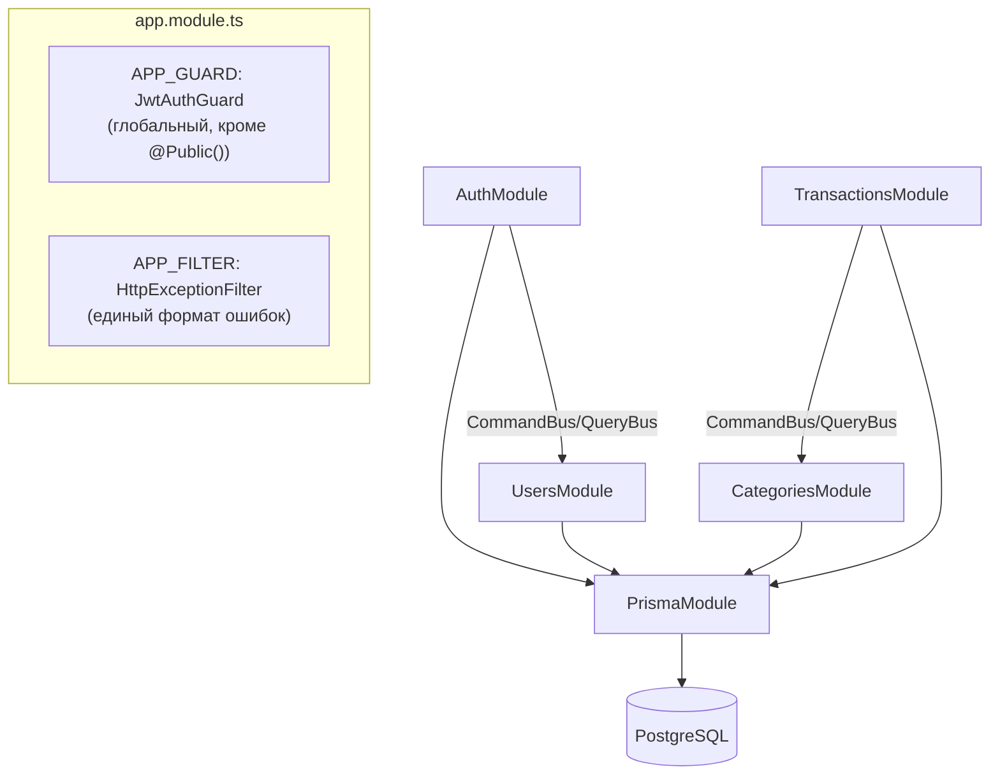
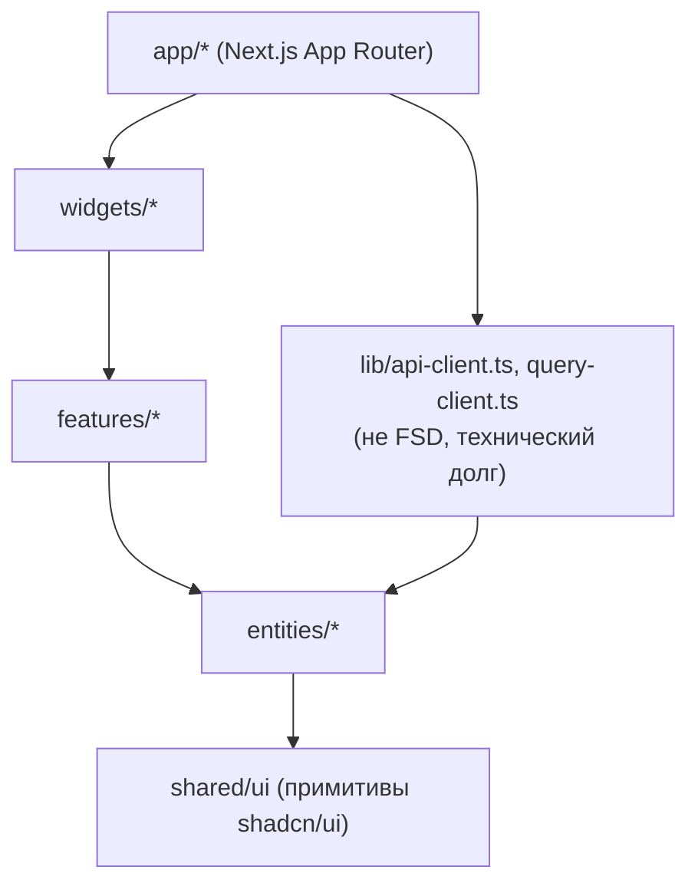

# Архитектура

## Обзор

Монорепозиторий трекера расходов на pnpm workspaces + Turborepo:

```
apps/
  web/      Next.js 16 (App Router) — фронтенд
  api/      NestJS 12 — бэкенд
packages/
  shared/             Zod-схемы и типы DTO — общий контракт web ↔ api
  eslint-config/       flat-конфиги ESLint: base / next / nest
  typescript-config/   базовые tsconfig: base / nextjs / nestjs
```

`apps/web` и `apps/api` не импортируют друг друга напрямую и не имеют общего
рантайма — единственная связь между ними на уровне типов и валидации это
`packages/shared`. Взаимодействие в проде — только по HTTP (`fetch` из
браузера на REST API).

```mermaid
graph LR
  Browser["Браузер"] -->|HTTP :3000| Web["apps/web (Next.js)"]
  Web -->|fetch, REST /api/*| Api["apps/api (NestJS)"]
  Api -->|@prisma/adapter-pg| DB[("PostgreSQL 17")]
  Shared["packages/shared\n(Zod-схемы, DTO-типы)"] -.->|tsc --build| Web
  Shared -.->|tsc --build| Api
```

Turborepo знает про зависимость `web`/`api` от `shared` через
`dependsOn: ["^build"]` в `turbo.json` — `shared` всегда собирается первым;
при `pnpm dev` три пакета собираются/запускаются параллельно, `shared` — в
watch-режиме (`tsc --build --watch`).

## packages/shared — единый контракт

Одна Zod-схема в `packages/shared/src/schemas/*.schema.ts` закрывает три роли
сразу:

1. валидация тела запроса на бэкенде — через `ZodValidationPipe`
   (`apps/api/src/common/pipes/zod-validation.pipe.ts`), навешивается точечно
   на `@Body()`/`@Query()`/`@Param()` конкретного хендлера;
2. типы DTO по обе стороны — через `z.infer<typeof schema>`;
3. валидация формы на фронте — через `zodResolver` в React Hook Form (там,
   где форма 1:1 совпадает с DTO; там, где нет — своя схема формы, см. ниже).

Рассинхрон контракта ловится компилятором TypeScript, а не в рантайме:
если бэкенд поменял форму ответа, а фронтенд ожидает старую — это ошибка
типов при сборке, а не баг, найденный в проде.

Файлы:

- `common.ts` — `idSchema` (UUID), `moneySchema` (сумма строкой, см.
  «Денежные суммы» ниже), `paginationQuerySchema`, `Paginated<T>`,
  `apiErrorSchema` (формат ошибки, который отдаёт `HttpExceptionFilter`);
- `enums.ts` — `TRANSACTION_TYPES`/`transactionTypeSchema` (зеркалит enum
  `TransactionType` из `schema.prisma`, пакет намеренно не зависит от
  `@prisma/client`, чтобы собираться и на фронтенде), `SUPPORTED_CURRENCIES`;
- `schemas/auth.schema.ts`, `schemas/category.schema.ts`,
  `schemas/transaction.schema.ts` — DTO и схемы ответов по доменам.

Добавление нового DTO: новая Zod-схема в `packages/shared/src/schemas/` →
экспорт из `packages/shared/src/index.ts` → использование в контроллере
через `ZodValidationPipe` и на фронте через `zodResolver`.

### Денежные суммы: строка, не число

`amount` везде на пути — строка (`moneySchema`: `^-?\d{1,10}(\.\d{1,2})?$`),
а не `number`. В базе это `Decimal(12,2)`; приведение к `number`/`float` в
любой точке пути (Prisma → сервис → HTTP → форма) даёт ошибку округления на
деньгах. Мапперы (`transaction.mapper.ts`) явно вызывают `.toFixed(2)` на
`Prisma.Decimal`, агрегаты в `TransactionsService.getSummary` считаются через
`Prisma.Decimal` (`.minus()`, `.toFixed(2)`), а не через `Number()`.

## apps/api — бэкенд

NestJS 12, модульная структура с CQRS-шиной (`@nestjs/cqrs`) для связи между
доменными модулями. Prisma 7 (`@prisma/adapter-pg`) — единственный доступ к
PostgreSQL 17.



### Модули и границы

Четыре доменных модуля: `auth`, `users`, `categories`, `transactions`.
Внутри каждого — типовой слой:

```
<module>/
  <module>.controller.ts   HTTP-роуты, ApiOperation/ApiResponse для Swagger
  <module>.service.ts      доменная логика — НЕ экспортируется из модуля
  <module>.repository.ts   единственное место обращения к Prisma в модуле
  <module>.mapper.ts        Prisma-модель → DTO ответа (явно перечисляет поля)
  commands/                 CQRS-команды + их хендлеры (мутации)
  queries/                  CQRS-запросы + их хендлеры (чтение)
```

`Service`/`Repository` — приватные детали модуля, provider'ы, но не
`exports`. Публичный контракт модуля наружу — только классы
Command/Query/Event из `commands/`/`queries/`/`events/`. Например,
`TransactionsService` не импортирует `CategoriesService` напрямую: чтобы
проверить, что `categoryId` в теле запроса принадлежит текущему пользователю,
он выполняет `GetCategoryByIdQuery` через `QueryBus`
(`transactions.service.ts` → `assertCategoryBelongsToUser`). Это осознанный
паттерн для всего проекта — при добавлении связи между двумя доменными
модулями всегда через Command/Query, никогда через прямой импорт сервиса.

`CqrsModule.forRoot()` вызывается ровно один раз, в `app.module.ts` — он
`global: true`; повторный вызов в другом модуле создал бы вторую пару
`CommandBus`/`QueryBus`, из-за которой команды/запросы перестали бы находить
свои хендлеры.

### Сквозные механизмы (app.module.ts)

- **`JwtAuthGuard` как `APP_GUARD`** — закрывает все маршруты по умолчанию.
  Публичные помечаются `@Public()` (`/health`, `/auth/register`,
  `/auth/login`). Guard читает метаданные через `Reflector`, пропускает
  запрос без проверки JWT, если хендлер или контроллер помечены.
- **`HttpExceptionFilter` как `APP_FILTER`** — приводит любое исключение
  (в т.ч. не-`HttpException`) к единому телу ответа, схема которого —
  `apiErrorSchema` в `shared`: `{ statusCode, message, errors?, timestamp,
  path }`. Ошибки 5xx дополнительно логируются со стек-трейсом.
- **Валидация окружения на старте** — `envSchema`
  (`apps/api/src/config/env.schema.ts`) подключена в `ConfigModule.forRoot({
  validate })`; некорректный `.env` роняет процесс на старте, а не всплывает
  посреди обработки запроса.
- **Валидация тела/query/param запроса** — точечно, `ZodValidationPipe` на
  каждом параметре, а не глобальный `ValidationPipe`. Nest'овский
  `ValidationPipe` и `class-validator`/`class-transformer` в проекте
  намеренно не используются (см. `apps/api/CLAUDE.md`); `nestjs-zod` тоже —
  несовместимая на момент создания проекта peer-зависимость с Nest 12.

### Доступ к данным — Prisma 7

`PrismaService` (`apps/api/src/prisma/prisma.service.ts`) расширяет
сгенерированный `PrismaClient`, подключается через драйвер-адаптер
`@prisma/adapter-pg` (в Prisma 7 датасорс в `schema.prisma` не содержит
`url` — строка подключения собирается в рантайме из `ConfigService`).
`onModuleInit`/`onModuleDestroy` управляют жизненным циклом соединения.

Правило по всем репозиториям: каждый метод, читающий/меняющий чужие данные,
принимает `userId` и фильтрует по нему в самом запросе Prisma (`where: {
id, userId }`), а не проверяет владельца после отдельного `findById`. Запись
`where: { id }` без `userId` в проекте не используется нигде — иначе чужая
запись становится доступной по прямому UUID.

### Авторизация

JWT на access-токене без refresh (15 минут по умолчанию, `JWT_EXPIRES_IN`).
`argon2id` для хеширования паролей. Подробности маршрутов и потока —
`apps/api/src/auth/README.md`. Общая схема: `JwtStrategy.validate` на каждый
запрос заново читает пользователя из БД через `GetUserByIdQuery` (осознанно —
удалённый пользователь не должен проходить по ещё не истёкшему токену) и
кладёт `{ id, email }` в `req.user`; `@CurrentUser()`/`@CurrentUser('id')`
достаёт это значение в контроллерах.

## apps/web — фронтенд

Next.js 16 (App Router) + React 19. Два слоя кода сосуществуют осознанно
(зафиксировано в `apps/web/CLAUDE.md` как временный технический долг):

- **Feature-Sliced Design** (`entities/`, `features/`, `widgets/`,
  `shared/ui`) — весь функционал авторизации и главного экрана дашборда;
- **обычные файлы** (`src/lib/*`, `src/stores/ui-store.ts`, страницы
  `(dashboard)/transactions|categories|stats`) — код, написанный до перехода
  на FSD, не мигрирован.



### Слои FSD

- `entities/session` — `useSessionStore` (Zustand + `persist`,
  `localStorage`-ключ `auth-session`): `accessToken`, `user`.
- `entities/transaction`, `entities/category` — хуки TanStack Query
  (`use-transactions.ts`, `use-categories.ts`), ключи запросов
  (`query-keys.ts`), презентационные компоненты строк списка.
- `features/auth/{login,register,logout}` — мутации + формы/пункты меню.
- `features/{categories,transactions}/create-*` — диалоги создания с
  собственной Zod-схемой формы (не сырой DTO-схемой из `shared` напрямую —
  например, `<input type="date">` отдаёт `YYYY-MM-DD`, а не полный ISO 8601).
- `widgets/app-header`, `widgets/transactions-list`, `widgets/categories-list`
  — композиция из entities/features для конкретного экрана.

### Состояние: TanStack Query vs Zustand

Чёткое разделение: всё, что приходит с сервера, живёт в TanStack Query
(кеш, инвалидация по мутациям); Zustand — только клиентское UI-состояние
(`ui-store.ts`: открыт ли сайдбар, текущий фильтр) и сессия (`session-store`,
персистентная). Серверные данные в Zustand не дублируются.

### HTTP-клиент

`lib/api-client.ts` — тонкая обёртка над `fetch` (не axios: нативный fetch
работает и в Server, и в Client Components). Токен читается через
`useSessionStore.getState()` (не хук — синхронный доступ вне React-дерева).
На 401 от API клиент сам сбрасывает сессию (`clearSession()`) — без
refresh-токена восстанавливать её нечем. В Server Components `accessToken`
всегда `null` (стор в `localStorage`, которого там нет), поэтому все
компоненты, читающие защищённые данные, — `'use client'`.

Осознанные границы: нет `middleware.ts`, защищающего `(dashboard)/*` роуты по
наличию токена (без токена страница рендерится, но запросы к API вернут
401); нет редиректа авторизованного пользователя с `/login`/`/register`.

## База данных

PostgreSQL 17 в Docker (`docker-compose.yml`), схема — Prisma
(`apps/api/prisma/schema.prisma`). Три таблицы: `users` 1—N `categories`
1—N `transactions`, `categoryId` у операции опционален. Подробности полей,
индексов и связей — в `database-schema.md`.

## Инфраструктура сборки

- **pnpm workspaces** — `apps/*`, `packages/*` (`pnpm-workspace.yaml`).
  `allowBuilds` там же — pnpm 11 по умолчанию блокирует postinstall-скрипты
  новых зависимостей, для нужных пакетов (`prisma`, `argon2`, `msw`,
  `@prisma/engines`, `unrs-resolver`) выставлен явный `true`.
- **Turborepo** — оркестрирует `dev`/`build`/`lint`/`typecheck`/`test` с
  учётом графа зависимостей (`turbo.json`). `globalPassThroughEnv`
  прокидывает переменные окружения из корневого `.env` в задачи обоих
  пакетов при `pnpm dev`/`pnpm build`.
- **Три версии, закреплённые намеренно** (не обновлять не глядя): Prisma
  ровно `7.10.0` (тег `latest` на момент создания указывал на `8.0.0-rc`),
  TypeScript `~6.0.3` (peer-ограничения `@nestjs/cli@12` и
  `typescript-eslint@8`), `nestjs-zod` не используется вовсе. Подробности —
  корневой `CLAUDE.md`, раздел «Три версии, зафиксированные намеренно».

## Тестирование

Vitest везде (не Jest). В `apps/api` два конфига: `vitest.config.ts` —
юнит/интеграционные тесты сервисов (`*.spec.ts`, Prisma не поднимается),
`vitest.config.e2e.ts` — `test/*.e2e-spec.ts`, которые поднимают весь
`AppModule`, включая `PrismaService.onModuleInit()` → реальный `$connect()`
(требуют `pnpm db:up`). В `apps/web` — `vitest.config.mts` (расширение
`.mts` обязательно, чтобы Vite однозначно грузил файл как ESM) + Testing
Library + MSW для мока HTTP-слоя в тестах компонентов
(`src/test/mocks/handlers.ts`).
