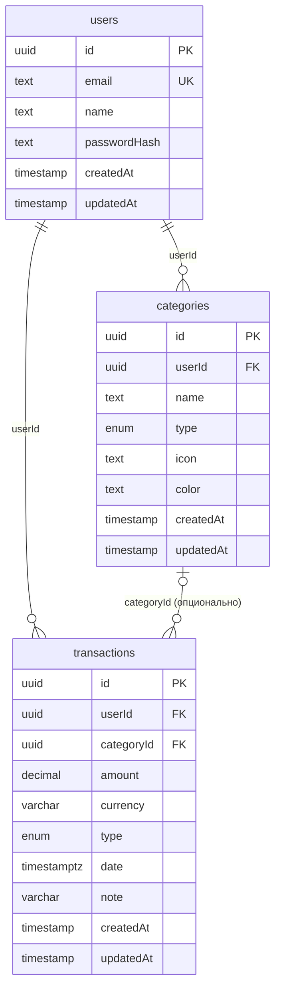

# Схема базы данных

PostgreSQL 17, схема описана в Prisma (`apps/api/prisma/schema.prisma`),
единственная точка доступа в рантайме — `PrismaService`
(`@prisma/adapter-pg`, без ORM-миграций на лету — только `prisma migrate`).
Миграции: `apps/api/prisma/migrations/`.

## `users`

| Поле | Тип (Prisma → Postgres) | Ограничения | Цель |
|---|---|---|---|
| `id` | `String @id @default(uuid()) @db.Uuid` → `uuid` | PK | Идентификатор пользователя; генерируется базой (`gen_random_uuid()` через дефолт Prisma), не приложением. |
| `email` | `String` → `text` | `@unique` | Логин при входе. Нормализуется (`trim().toLowerCase()`) в `UsersService` **до** записи — в схеме БД регистронезависимость не гарантирована на уровне constraint, полагаться на неё можно только пройдя через `UsersService`. |
| `name` | `String` → `text` | обязательно | Отображаемое имя, не участвует в аутентификации. |
| `passwordHash` | `String` → `text` | обязательно (с миграции `user_password_hash_required`) | `argon2id`-хеш пароля. Пишется только в `CreateUserCommand`; наружу (в `UserResponse`/`api`) никогда не отдаётся — маппер `user.mapper.ts` явно перечисляет поля ответа. Изначально было nullable — вторая миграция сделала обязательным после того, как первые пользователи стали создаваться исключительно через `register`. |
| `createdAt` | `DateTime @default(now())` → `timestamp(3)` | — | Момент регистрации. |
| `updatedAt` | `DateTime @updatedAt` → `timestamp(3)` | — | Обновляется Prisma автоматически при любом `update`. |

**Связи:** 1—N с `categories` и `transactions` через `userId`, `onDelete:
Cascade` в обе стороны — удаление пользователя удаляет все его категории и
операции.

## `categories`

| Поле | Тип (Prisma → Postgres) | Ограничения | Цель |
|---|---|---|---|
| `id` | `String @id @default(uuid()) @db.Uuid` → `uuid` | PK | Идентификатор категории. |
| `userId` | `String @db.Uuid` | FK → `users.id`, `onDelete: Cascade` | Владелец категории; категории приватны для пользователя, между пользователями не расшариваются. |
| `name` | `String` → `text` | часть уникального индекса `[userId, name]` | Название категории («Продукты», «Зарплата» и т.п.), 1-50 символов на уровне Zod-схемы `createCategorySchema`. |
| `type` | `TransactionType` (enum) → `"TransactionType"` | `INCOME` \| `EXPENSE` | Категория жёстко привязана к одному типу операций — категория расходов не может быть выбрана для дохода (проверяется на уровне бизнес-логики форм/DTO, не отдельным DB constraint). |
| `icon` | `String?` → `text`, nullable | опционально | Идентификатор иконки для UI (см. `apps/web/src/entities/category/lib/category-icons.ts`), до 50 символов. |
| `color` | `String?` → `text`, nullable | опционально | HEX-цвет вида `#RRGGBB` для UI (`category-colors.ts`), формат проверяется Zod-схемой, не DB constraint. |
| `createdAt` / `updatedAt` | как у `users` | — | Аудит. |

**Индексы:**
- `@@index([userId])` — обслуживает `findManyByUser`, самый частый запрос
  модуля (список категорий пользователя для UI и для сводки транзакций).
- `@@unique([userId, name])` — у одного пользователя не может быть двух
  категорий с одинаковым именем (сообщение `409 Conflict` в API); разные
  пользователи могут называть категории одинаково.

**Связи:** 1—N с `transactions` через `categoryId`, `onDelete: SetNull` —
удаление категории **не** удаляет операции, а обнуляет их `categoryId`
(операция становится «без категории», а не пропадает).

## `transactions`

| Поле | Тип (Prisma → Postgres) | Ограничения | Цель |
|---|---|---|---|
| `id` | `String @id @default(uuid()) @db.Uuid` → `uuid` | PK | Идентификатор операции. |
| `userId` | `String @db.Uuid` | FK → `users.id`, `onDelete: Cascade` | Владелец операции. |
| `categoryId` | `String? @db.Uuid`, nullable | FK → `categories.id`, `onDelete: SetNull` | Категория **необязательна** — операцию можно завести до её разбора по категориям (комментарий в схеме прямо это фиксирует). |
| `amount` | `Decimal @db.Decimal(12, 2)` → `numeric(12,2)` | обязательно | Сумма операции. Намеренно `Decimal`, не `Float` — на деньгах `Float` накапливает ошибку округления; `Decimal(12,2)` точно ложится на `numeric(12,2)`. На границе API отдаётся строкой (`moneySchema`/`.toFixed(2)`), см. `architecture.md` → «Денежные суммы». |
| `currency` | `String @default("USD") @db.VarChar(3)` → `varchar(3)` | ISO 4217, ограничено `SUPPORTED_CURRENCIES` на уровне Zod (`USD`, `EUR`, `RUB`, `GEL`, `KZT`) | Валюта операции. **Не** участвует в группировке при агрегации сводки — `TransactionsService.getSummary` суммирует все операции пользователя за период независимо от валюты (мультивалютный сплит не реализован, это известное упрощение). |
| `type` | `TransactionType` (enum) | `INCOME` \| `EXPENSE` | Тип операции; независим от `type` связанной категории на уровне БД (согласованность — забота бизнес-логики/UI, не FK/constraint). |
| `date` | `DateTime @db.Timestamptz(3)` → `timestamptz(3)` | обязательно | Дата/время самой операции (не создания записи). Хранится с часовым поясом намеренно — агрегация по месяцу (`GET /transactions/summary`) считает границы в UTC, и `timestamptz` даёт однозначное сравнение независимо от таймзоны клиента БД. |
| `note` | `String? @db.VarChar(500)`, nullable | опционально | Свободный комментарий к операции, до 500 символов. |
| `createdAt` / `updatedAt` | как у `users` | — | Аудит; `createdAt` также используется как вторичный ключ сортировки списка (`date desc, createdAt desc`) — при одинаковой `date` порядок стабилен. |

**Индексы:**
- `@@index([userId, date])` — составной, под основной сценарий чтения:
  лента операций пользователя за период (`GET /transactions` с
  фильтрами `from`/`to`, `GET /transactions/summary`).
- `@@index([categoryId])` — под `sumByCategory`/фильтр `categoryId` в списке
  и под сам FK.

## Общие решения, зафиксированные намеренно

- **UUID, а не автоинкремент**, везде — `id` генерируется базой
  (`@default(uuid())`), не зависит от порядка вставки, безопасно
  использовать в публичных URL.
- **Мягкого удаления (soft delete) нет** — `DELETE` в API соответствует
  реальному `DELETE`/`deleteMany` в БД. У `transactions` это осознанно
  просто (не нужна история удалённых операций); у `categories` — обнуление
  ссылок через `SetNull` играет ту же защитную роль, что и soft delete, но
  для дочерних записей, а не для самой категории.
- **Каждый repository-метод фильтрует по `userId` в самом запросе** —
  `where: { id, userId }`, а не `where: { id }` с последующей проверкой
  владельца в коде. Это защита от IDOR: чужая запись просто не находится
  запросом, а не отклоняется дополнительной проверкой (единая практика для
  `categories.repository.ts` и `transactions.repository.ts`).
- **Даты — `timestamp(3)`/`timestamptz(3)`**, точность до миллисекунд;
  `Timestamptz` выбран точечно только там, где часовой пояс операции важен
  для агрегации (`transactions.date`), а не по умолчанию для всех дат.

## Миграции

Две миграции на данный момент:

1. `20260828135645_init` — начальная схема: три таблицы, enum
   `TransactionType`, все индексы и FK из раздела выше.
2. `20260828143414_user_password_hash_required` — `users.passwordHash`
   переведён из nullable в `NOT NULL` (см. пояснение в таблице `users`
   выше).

Применение: `pnpm db:migrate` (`prisma migrate dev` в `apps/api`, читает
`DATABASE_URL` через `apps/api/prisma.config.ts` и общий `.env` в корне
монорепо). Генерация клиента — `pnpm db:generate`, результат — в
`apps/api/src/generated/prisma` (внутри `rootDir`, чтобы `nest build` его
подхватывал); пересоздавать после любого изменения `schema.prisma`.
